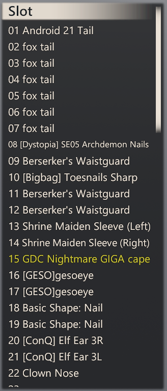
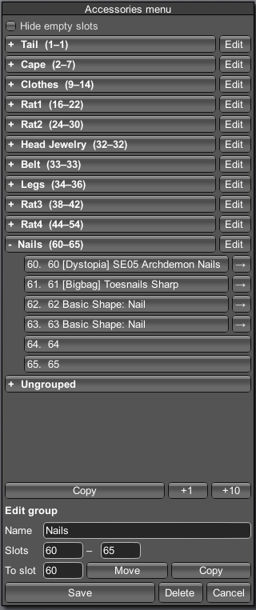

# Advanced Accessories Menu

A plugin that gives ability to create groups for accessory slots.

Supported games: HS2, AI, KK, KKS

| Old menu messy | | New menu clean |
|---|:---:|---|
|  | ➜ |  |

## Features

- Create groups for accessory slots.
- Copy and move entire groups at once.
- Toggle between advanced menu and old style.
- Empty slots can be hidden.
- KKS / KK outfits have their own groups.

## Requirements

- [BepInEx](https://github.com/BepInEx/BepInEx) 5.4
- [HS2API / KKSAPI / AIAPI](https://github.com/IllusionMods/IllusionModdingAPI) 1.48 or newer, KKAPI 1.42.2 or newer

## Installation

Copy .dll into `BepInEx\plugins`.

## Usage

1. Press **Advanced** button to toggle between new menu and old.
2. Create groups by giving them a name and set range.
3. Move/copy entire groups to another slot.

## Compatibility

| Plugin | HS2 / AI | KKS / KK |
|---|---|---|
| MoreAccessories | [1.2.2+](https://bitbucket.org/Joan6694/hsplugins) | [2.0.21+](https://github.com/jalil49/MoreAccessories) |
| SliderHighlight | — | 2.2+ |

## Changelog

- 0.1.0 — first version.

## License

GPL-3.0, see [LICENSE](LICENSE).
