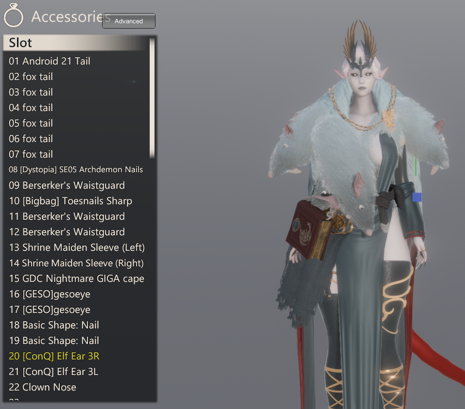
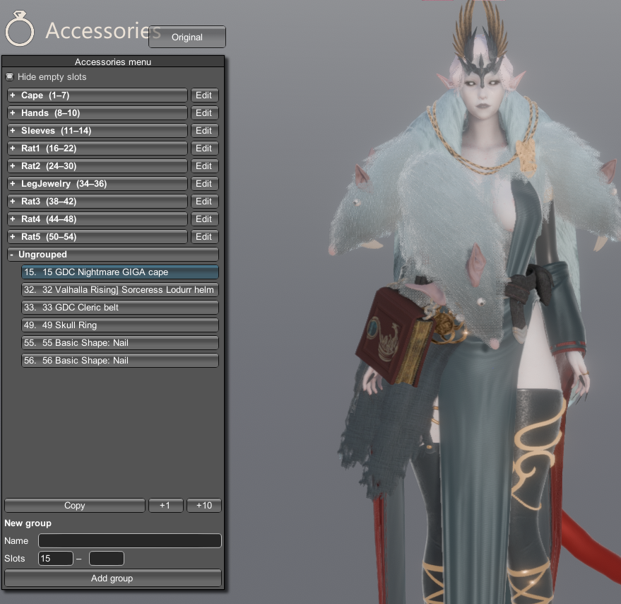
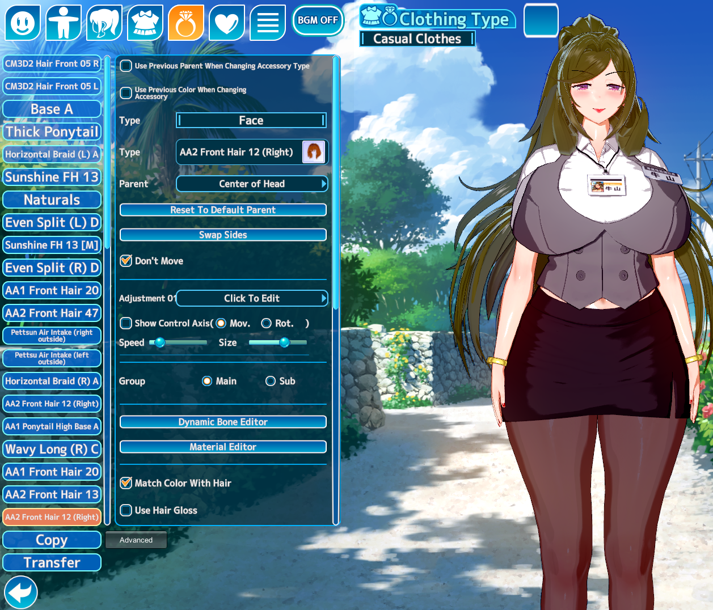
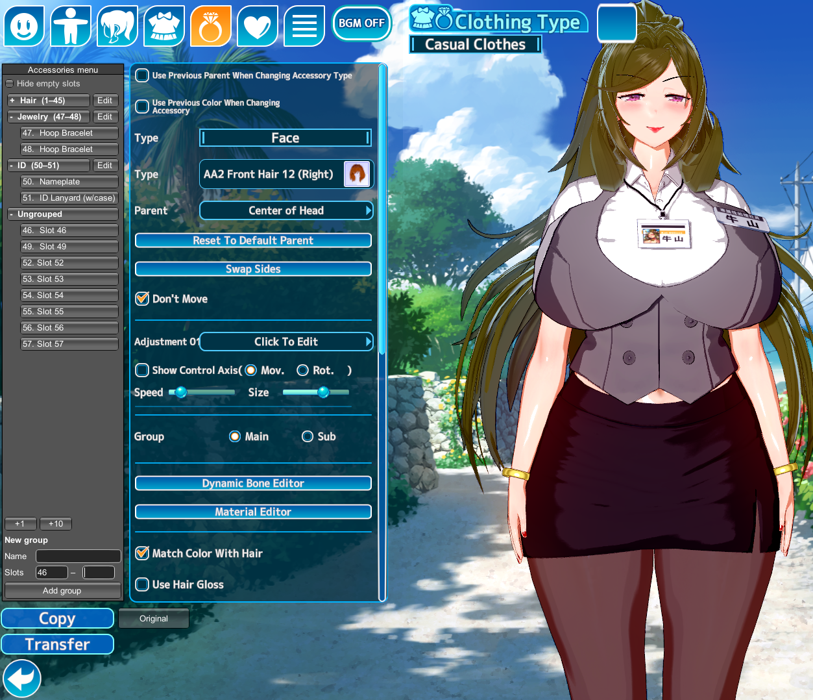

# Advanced Accessories Menu

A plugin that sorts accessory slots in the character maker into named, collapsible groups.

Supported games: Honey Select 2, Koikatsu Sunshine, Koikatsu.
Also built for AI-Shoujo, but not tested there yet.

| Game's slot list | | Accessories menu |
|---|:---:|---|
|  | ➜ |  |
|  | ➜ |  |

## Features

- **Advanced** button that replaces the game's slot list with the Accessories menu and back.
- Groups of slot ranges (e.g. Hair 1–10, Piercing 11–13) that can be collapsed.
- Groups can't overlap; a new group starts at the first free slot.
- Clicking a slot selects it in the game's accessory menu, the same as clicking it there.
- Slots outside any group are listed under *Ungrouped*.
- Empty slots can be hidden.
- Groups are saved on the character card and on clothes cards. In Koikatsu Sunshine / Koikatsu every outfit has its own groups.
- Fixes old accessory names in new MoreAccessories slots after *+1* / *+10*.
- The game's original accessory list is not changed.

## Screenshots

| Game's slot list | | Accessories menu |
|---|:---:|---|
|  | ➜ |  |

## Requirements

- [BepInEx](https://github.com/BepInEx/BepInEx) 5.4
- [HS2API / KKSAPI / AIAPI](https://github.com/IllusionMods/IllusionModdingAPI) 1.48 or newer, KKAPI 1.42.2 or newer

## Installation

Copy the file for your game into `BepInEx\plugins`:

- Honey Select 2: `HS2_AdvancedAccessoriesMenu.dll`
- Koikatsu Sunshine: `KKS_AdvancedAccessoriesMenu.dll`
- AI-Shoujo (not tested): `AI_AdvancedAccessoriesMenu.dll`
- Koikatsu: `KK_AdvancedAccessoriesMenu.dll`

## Usage

1. In the character maker open *Accessories* and press **Advanced** (Honey Select 2 / AI-Shoujo: next to the *Accessories* title; Koikatsu Sunshine / Koikatsu: next to *Copy*).
2. Enter a name and the last slot, then press **Add group**.
3. Click a slot to edit it in the game's accessory menu.

A keyboard shortcut for the menu can be set in the plugin settings (F1).

## Compatibility

| Plugin | HS2 / AI | KKS / KK |
|---|---|---|
| MoreAccessories | [1.2.2+](https://bitbucket.org/Joan6694/hsplugins) | [2.0.21+](https://github.com/jalil49/MoreAccessories) |
| SliderHighlight (accessory highlight on hover) | — | 2.2+ |

## Changelog

- 0.1.0 — first version.

## License

GPL-3.0, see [LICENSE](LICENSE).
